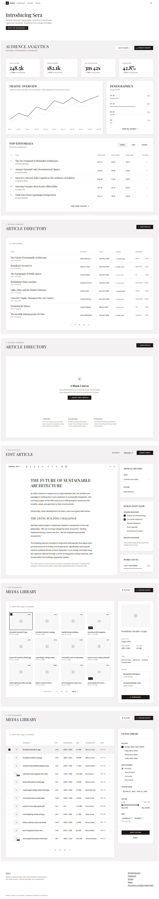

# Sera

shadcn's Sera, rebuilt with Semantic Components as a small website: the same screens, colours and fonts, our components. This is an app — not the presets library (`libs/presets`), whose `sera` preset it uses.

- **Source**: shadcn-ui/ui, `apps/v4/app/(app)/(styles)/sera` (MIT): six screens on `base-sera` — Audience Analytics, Article Directory, Empty State, Edit Article, Media Library, Media Library Table.
- **Look**: the Sera preset (`app.config.ts`); shadcn's `taupe` theme, light and dark, square corners, and its fonts — Playfair Display for headings, Noto Sans for the text — in `styles.css` and `index.html`.
- **Charts**: the library's, as they are (Recharts' API).

```sh
npx nx serve sera   # http://localhost:4202
```

`/screens` — shadcn's six screens on one page, in the site (light, 1440px wide):



## The website

A header (the Sera mark, the pages, the theme — Light, Dark, System, the library's `ScThemeManager`; a menu on a phone), the page, a footer — `layouts/site-layout.ts`. One width for every page: content up to 1400px, its sides the screens' `--gap` (1rem, 1.5rem from md, 2rem from xl) — `px-(--page-gutter)` on each full-width part (`styles.css`). Not shadcn's: its screens have no navigation; the pages link to each other through them.

| Route           | Page                                                                                         | From (`src/app/`)                                        |
| --------------- | -------------------------------------------------------------------------------------------- | -------------------------------------------------------- |
| `/`             | **Introducing Sera**: the hero, the pages, the issues, the style                             | `pages/home-page/`                                       |
| `/dashboard`    | Audience analytics                                                                           | `screens/audience-analytics/`                            |
| `/articles`     | The articles; `?issue=` filters them — an issue without any (Spring 2025) is the empty state | `screens/article-directory/`, `screens/empty-state/`     |
| `/articles/:id` | An article to edit (`new`: a blank one); its title opens it from the list                    | `screens/edit-article/`                                  |
| `/media`        | The media, as a grid or a table (a switch in the header)                                     | `screens/media-library/`, `screens/media-library-table/` |
| `/screens`      | shadcn's announcement as it is: its header, then the six screens                             | `pages/sera-page/`                                       |

The breadcrumbs lead to the pages ("Editorial Dashboard", "Back to articles", "Asset management"); "Create first article" opens a new one. The pages are in `pages/app-pages.ts`; the articles and issues in `screens/article-directory/articles-data.ts`, the media in `screens/media-library/media-data.ts`.

## The screens alone

Each screen also has its own route, full page and without the site — to compare with shadcn's and to take screenshots: `/audience-analytics`, `/article-directory`, `/empty-state`, `/edit-article`, `/media-library`, `/media-library-table`.

Each follows shadcn's file of the same name, with our parts. Where they differ, on purpose:

- **Dark mode from the header's menu**: shadcn's `.dark` taupe colours; its page has the switcher commented out. The traffic chart's colours follow shadcn's `theme: { light, dark }` through `--traffic-views` / `--traffic-unique`.
- **One page width**: shadcn's screens are full width with their own `container`; here every page's content is on the same 1400px column.
- **Dates with `Temporal`**, not `Date` and date-fns.
- **Pagination keeps its own state**: shadcn's three static pages are `totalItems` / `pageSize`; Previous is disabled on page 1.
- **One `h1` per screen**: Edit Article's article title is an `h2` (shadcn's is an `h1` under the page's `h1`).
- **Icon buttons named by an `sr-only` span**, not `aria-label`.
- **Lucide's newer names**: Funnel, Ellipsis, EllipsisVertical, CodeXml, TextAlignStart/Center/End.
- **The traffic chart's dashed line, dotted grid and marked point** are classes on our chart parts (no `strokeDasharray` or `ReferenceDot` input).
- **The size filter** is our Range Slider (two thumbs); our Slider has one.
- **Links where shadcn's go nowhere**: the breadcrumbs, the article titles, "Create first article"; the media header's grid/table switch, only on the site.
