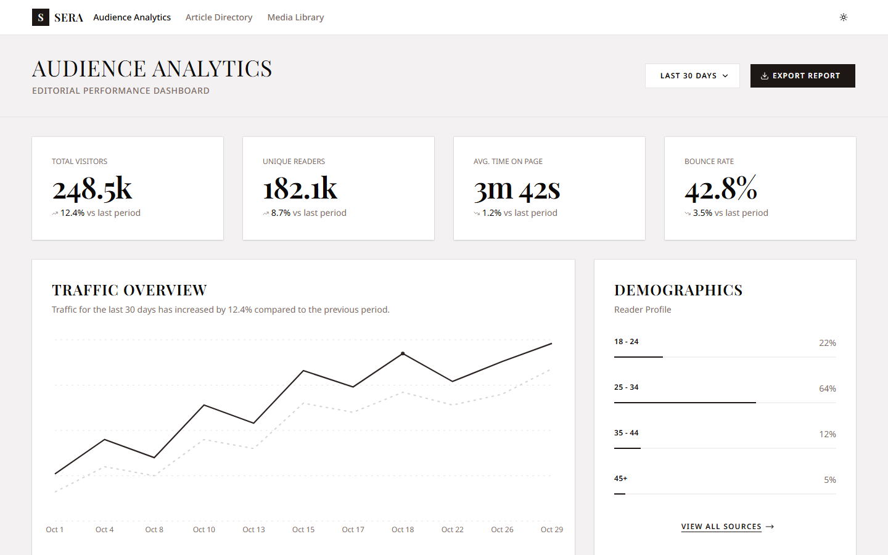

# Sera

An editorial workspace built with Semantic Components in shadcn's Sera style: audience analytics, an article directory with its editor, a media library. Every link goes to a page and every button does what it says. This is an app, not the presets library (`libs/presets`), whose `sera` preset it uses.

- **Design**: shadcn-ui/ui, `apps/v4/app/(app)/(styles)/sera` (MIT): its screens on `base-sera`.
- **Look**: the Sera preset (`app.config.ts`); shadcn's `taupe` theme, light and dark, square corners, and its fonts (Playfair Display for headings, Noto Sans for the text) in `styles.css` and `index.html`.
- **Data**: in memory, in two stores: `ArticleStore` (`screens/article-directory/article-store.ts`) and `MediaStore` (`screens/media-library/media-store.ts`). A reload starts again from the samples. Put your API behind the stores; the pages don't change.

```sh
npx nx serve sera   # http://localhost:4202
```



## Pages

The header holds the Sera mark, the pages (named as their titles), and the theme menu (Light, Dark, System: the library's `ScThemeManager`). On a phone they move into a menu. Below it is the page, then a footer (`layouts/site-layout.ts`). Every page uses one column: content up to 1400px, with sides of the screens' `--gap` (`px-(--page-gutter)`, `styles.css`).

| Route           | Page                                                                                                        | From (`src/app/`)                                        |
| --------------- | ----------------------------------------------------------------------------------------------------------- | -------------------------------------------------------- |
| `/`             | **Introducing Sera**: the hero, the pages, the issues, the style                                            | `pages/home-page/`                                       |
| `/dashboard`    | **Audience Analytics**                                                                                      | `screens/audience-analytics/`                            |
| `/articles`     | **Article Directory**; `?issue=` shows one issue's articles, and an issue without any shows the empty state | `screens/article-directory/`, `screens/empty-state/`     |
| `/articles/:id` | **Edit Article**; `new` starts a blank one                                                                  | `screens/edit-article/`                                  |
| `/media`        | **Media Library**, as a grid or a table (the switch in its header)                                          | `screens/media-library/`, `screens/media-library-table/` |

## What works

- **Audience Analytics**
  - **Export Report** downloads the dashboard as a CSV file (metrics, readers, sources, top editorials).
  - **View all sources** opens the readers' sources in a dialog.
  - **Top Editorials** ranks by Views, Time or Shares. Each row's menu can **Edit** the article, **Unpublish** it or **Delete** it (each with Undo), and the directory follows.
- **Article Directory**
  - **Search** by title or author, 8 articles a page.
  - A title opens the article.
  - **New Article** opens a blank one.
  - An issue (from the home page) shows only that issue's articles, with a link back to all of them.
- **Edit Article**
  - The text is in the library's editor (Tiptap) under shadcn's toolbar: text style and lists, bold, italic, underline, strikethrough, code, alignment, link, image (kept in the page), undo, redo.
  - The title, issue, author, milestones and note are one Signal Form.
  - Word Count counts the text.
  - The badge shows whether the draft is saved.
  - **Preview** shows the article as readers will see it.
  - **Submit Draft** saves it (a new one or a draft goes to revision) and returns to the list.
- **Media Library**
  - **Upload Assets** adds images, MP4 and PDF files, shown and measured.
  - **Search** by name or tag, 8 assets a page.
  - The details card: **Add tag**, remove a tag, **Download** (an upload's file; a sample has none, and a toast says so).
  - **Filters** switches to the table; the filter panel's **Apply Filters** and **Reset** act on the table.
  - Each table row's menu: **Preview** (in the grid, with its details), **Download**, **Delete** (with Undo).
- **Toasts** confirm each action (`layouts/toaster.ts`, the library's `ScToaster`).

## Differences from shadcn's screens

- **The site around them**: navigation, a home page, links between the pages.
- **Real data and actions** where shadcn's are static: pagination counts the actual items, Previous is disabled on page 1, and the article's progress is its publication flow (the milestones reached).
- **Dark mode from the header's menu**: shadcn's `.dark` taupe colours. The traffic chart's colours follow shadcn's `theme: { light, dark }` through `--traffic-views` / `--traffic-unique`.
- **Dates with `Temporal`**, not `Date` and date-fns.
- **One `h1` per page**: Edit Article's title is a field under the page's `h1`.
- **Icon buttons named by an `sr-only` span**, not `aria-label`.
- **Lucide's newer names**: Funnel, Ellipsis, EllipsisVertical, CodeXml, TextAlignStart/Center/End.
- **The traffic chart's dashed line, dotted grid and marked point** are classes on the library's chart parts. The charts still use the library's own look.
- **The size filter** is the library's Range Slider (two thumbs).
